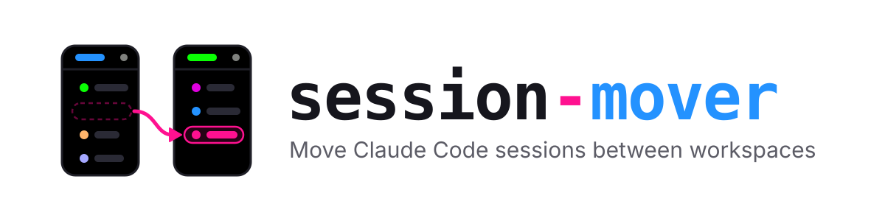

<h1 align="center">
	<picture>
		<source media="(prefers-color-scheme: dark)" srcset="docs/brand/banner-dark.svg">
		
	</picture>
</h1>

<p align="center">
	<strong>Move sessions between workspaces in the Claude desktop app's Code tab.</strong>
</p>

<p align="center">
	<a href="https://github.com/webdevnerdstuff/claude-session-mover/releases/latest"></a>
	<a href="https://github.com/webdevnerdstuff/claude-session-mover/actions/workflows/ci.yml"></a>
	
	<a href="LICENSE"></a>
</p>

The app has no way to change a session's workspace once it is made: session-mover adds a pane where you pick the new workspace for each session, then quits Claude, moves them, and reopens it.

## Why use it

> [!TIP]
> **Moving sessions uses zero tokens.** Asking Claude to move a session for you can take a lot of back and forth, and every round of it spends tokens you could use on real work. session-mover takes that out of the equation: it runs locally, never calls the model, and moves your sessions in a few clicks.

- **Uses no tokens**: everything runs on your Mac, never through Claude
- Lists your sessions by workspace, with a **Move to** picker on each
- Queue several moves, undo any of them, then apply them all at once
- Moves the session's folder, its sidebar workspace and its conversation history together
- Backs up everything it changes before changing it

> [!WARNING]
> session-mover is unofficial. It edits files the Claude desktop app keeps for itself, which the app does not document and may change in any update. Each run keeps a backup, but use it at your own risk.

## Requirements

- macOS, with the Claude desktop app in `/Applications`
- `python3` (run `xcode-select --install` once if macOS says it is missing)
- Claude Code 2.1.287 or newer

## Install

In a Claude Code terminal session:

```bash
/plugin install session-mover --marketplace webdevnerdstuff/claude-session-mover
```

Answer `y` to add the marketplace, then pick **user** scope so it loads in every session, the desktop app's included.

### Update and remove

To update, refresh the marketplace, then update the plugin and restart Claude Code:

```bash
claude plugin marketplace update claude-session-mover
claude plugin update session-mover@claude-session-mover
```

To remove it:

```bash
claude plugin uninstall session-mover@claude-session-mover
```

## Use

1. Run `/move-sessions` in any Code session. The **Move sessions** pane opens.

   **In a terminal**, the pane docks beside the chat only in Claude Code's fullscreen renderer: run `/tui fullscreen` once to turn it on for every session. Without it, the pane opens above the prompt, where <kbd>↑</kbd> and <kbd>↓</kbd> scroll a long list and <kbd>Tab</kbd> moves between controls. If the keys go back to the prompt, press <kbd>Ctrl</kbd>+<kbd>X</kbd> <kbd>Tab</kbd> (twice if a mod puts a bar above the prompt) or run `/move-sessions` again.

2. Pick a workspace under **Show**, or keep **All workspaces** for every session, newest first. A long list is split into pages; use **Previous** and **Next** to move between them.
3. Set **Move to** on each session you want to move. The moves wait under **Queued moves**, each with **Undo**.
4. Click **Apply & restart Claude**, then **Quit and move**.

Claude quits, the moves are applied, and Claude reopens on its own, usually within a few seconds. In the first session after the restart, a toast says what moved or what went wrong.

Anything running in Claude stops when it quits, so finish or pause running sessions first. If Claude has not quit within 2 minutes, nothing is changed and Claude is reopened.

## What a move changes

A workspace is one of the app's environment presets: a name and a folder. For each session it moves, session-mover:

- Points the session's own file at the workspace's folder and environment ID
- Changes the session's entry in the app's Local Storage map, which the sidebar groups sessions by
- Copies the session's conversation history to the new folder's project, so it resumes there; the original stays where it was

The sidebar only reads that map while Claude is quit, which is why every move needs a restart.

### Backups and undoing a move

Each run makes a folder `~/claude-session-backups/mover-<time>/` holding:

- each moved session's file as it was
- the app's whole Local Storage folder (`leveldb/`) as it was
- `moves.json`, what was asked, and `apply.log`, what happened

To undo a run, quit Claude, copy the session files back into `~/Library/Application Support/Claude/claude-code-sessions/<account>/<org>/`, and replace `~/Library/Application Support/Claude/Local Storage/leveldb` with the backup's `leveldb/`. Or simply move the sessions back with the pane.

## Develop

```bash
pnpm check  # validates, runs the engine tests and the helper's tests
```

Load it from the folder while you work on it: `claude --plugin-dir .`. See [AGENTS.md](AGENTS.md) for how it is put together.

## License

MIT © WebDevNerdStuff
